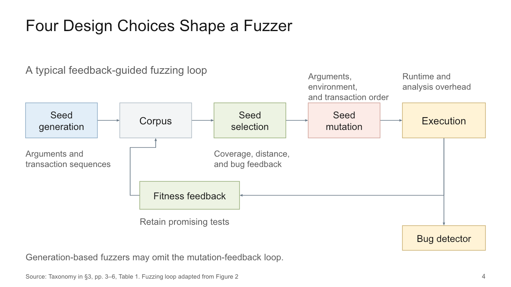
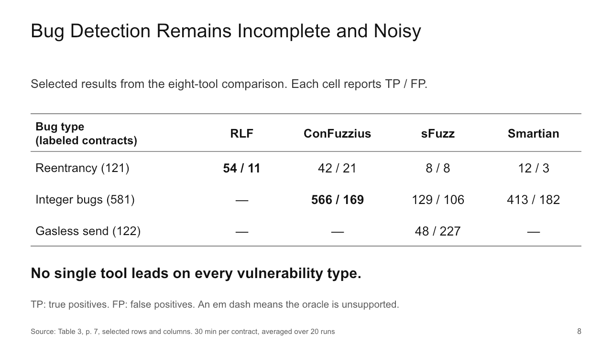

# Research Paper Slides

**先读懂论文，再做一套讲得清楚、可以编辑的科研汇报 PPT。**

`research-paper-slides` 是用于 Codex 的科研论文汇报技能，适合文献汇报、组会和学术报告。它仿照顶会论文报告的 PPT 风格，提炼真实报告中的版式、图表组织和讲述方法，再根据目标论文重新设计页面。

工作流程是：**确定页数 → 阅读论文 → 确认逐页文案 → 直接制作可编辑 PPT → 逐页渲染、检查与修复**。

## 生成效果

以下两张截图来自使用本技能制作的 **12 页英文论文汇报**，论文为 Wu et al., *Are We There Yet? Unraveling the State-of-the-Art Smart Contract Fuzzers*, ICSE 2024，[arXiv:2402.02973](https://arxiv.org/abs/2402.02973)。截图展示实际生成的幻灯片。

### 方法讲解页

采用浅色语义模块与细连接线，先给出完整流程，再解释输入、变换和反馈。图中的节点、文字和箭头在 PPT 中可编辑。



### 实验证据页

将论文表格中的选定结果整理为原生表格，保留实验条件、TP / FP 含义、来源和不支持的检测类型。



## 顶会风格从哪里来

本技能参考了三份真实论文报告，共 52 页，从中归纳出三种视觉变体。它借鉴的是视觉风格与学术叙事方法，不是会议官方模板，也不代表原作者或会议的认可。

| 变体 | 风格特点 | 参考报告 |
| --- | --- | --- |
| `minimal-technical` | 白底、左对齐标题、浅色模块、总图到局部的技术拆解、简洁结果表格 | *Where We Are and What We’re Looking At: Query Based Worldwide Image Geo-localization Using Hierarchies and Scenes* |
| `navy-explainer` | 深蓝标题区、固定案例、从失败现象引出机制，再解释改进 | *Catch Missing Details: Image Reconstruction with Frequency Augmented Variational Autoencoder* |
| `visual-evidence` | 白底、大幅科研图片、同例对齐比较、明确控制变量 | *PAIR Diffusion: A Comprehensive Multimodal Object-Level Image Editor* |

共同原则是：尽早交代贡献，方法先整体后局部，实验回答具体科学问题，结尾保留证据边界。不会机械套用“背景—意义—技术路线—进度”的项目汇报结构。

具体观察与来源记录见 [参考报告研究](references/source-study.md)、[视觉系统](references/visual-system.md)和[素材来源](assets/source-provenance.json)。参考页用于指导风格；新报告中的模型、数据、图表和结论必须来自用户提供的论文。

## 安装

需要能读取本地 skills 的 Codex 环境。将整个仓库放进 Codex 的技能目录，而不是只复制 `SKILL.md`：

```bash
git clone https://github.com/longze611/research-paper-slides.git \
  "${CODEX_HOME:-$HOME/.codex}/skills/research-paper-slides"
```

安装后重新打开 Codex 会话，或按当前客户端方式刷新技能列表。若目标目录已有同名技能，请先保留自己的修改，再选择更新或使用另一目录，避免覆盖。

### 运行条件

- Codex 需要能读取目标论文 PDF 和本技能的参考素材。
- 制作 PPT 需要当前环境提供的 `Presentations` 技能，以及支持原生文本、表格、形状、连接线、PPTX 导出和逐页渲染的工具。当前实现可使用 `@oai/artifact-tool`；它不是仓库自带的独立 PPT 引擎。
- PDF 阅读与图表裁切需要可用的 PDF 工具。
- 可选的静态检查脚本使用 Python 3 和 Pillow。
- 当前流程直接制作可编辑 PPT，不调用整页图片生成 API，无需为图片生成配置 `OPENAI_API_KEY`。

如果所在环境缺少 PPTX 制作或渲染能力，仅安装这个仓库不会自动补齐这些工具。

## 使用方式

在 Codex 中引用技能，并提供论文文件。例如：

```text
请使用 $research-paper-slides，为这篇论文制作 12 页英文汇报 PPT。
论文：/path/to/paper.pdf
面向组会听众，重点讲清问题、方法、关键实验和局限。
请先给我逐页结构和展示文案，确认后再制作。
```

也可以先不指定页数：

```text
请使用 $research-paper-slides，制作这篇论文的文献汇报 PPT。
论文：/path/to/paper.pdf
```

### 交互流程

1. **确定页数。** 没有指定时先询问；已经指定就直接沿用。总页数包含封面和结尾。
2. **阅读论文并生成文案。** 按指定页数给出每页标题、核心结论、展示文字、拟用图表及出处。
3. **等待文案确认。** 可以直接提出修改，例如“第 3 页压缩背景，第 7 页增加实验设置”。确认后说“文案可以，继续制作”。
4. **选择并锁定风格。** 可以指定上面的任一变体；未指定时由技能根据论文内容选择。
5. **直接制作可编辑 PPT。** 文本、表格、流程节点和连接线优先使用原生对象；有可靠数据时制作原生图表。
6. **渲染、检查、修复、复检。** 逐页检查文字重叠、图像遮挡、溢出裁切，以及流程箭头方向、源目标和端点位置，发现问题后修改源文件并重新检查。

可继续追加要求：

```text
使用 minimal-technical 风格，16:9。
第 5 页保留论文原始方法图，第 8 页把结果整理成可编辑表格。
```

## 交付内容

完整流程通常包含：

- 可编辑 `.pptx`。
- 逐页渲染图片，以及联系表或 PDF 预览。
- 已确认的逐页文案、内容计划、事实来源和样式记录。
- 可复现的制作源文件、所需素材、元素映射与检查记录，可合并为 ZIP。

“可编辑”主要指文本、表格和可重建的流程结构。论文中的照片、热图、复杂插图及缺少完整原始数据的曲线可以保留为图片，并说明范围。不会猜测曲线数据，也不会用一张整页图片冒充可编辑幻灯片。

## 质量检查

除实际逐页目视检查外，可以运行静态检查助手：

```bash
python -m pip install Pillow
python scripts/audit_outputs.py \
  --renders /path/to/project/renders \
  --pptx /path/to/project/output/report.pptx \
  --plan /path/to/project/content-plan.json \
  --report /path/to/project/qa-static.json
```

渲染图片使用 `S01.png`、`S02.png` 等连续命名。脚本检查画幅、页数、PPTX 结构和计划中的原生对象下限；它不能判断字形是否重叠、连线语义是否正确，也不能替代实际编辑验证。详细标准见 [质量门槛](references/quality-gates.md)。

## 仓库结构

```text
research-paper-slides/
├── SKILL.md                       # 技能入口与工作流程
├── agents/openai.yaml             # Codex 展示信息
├── references/                    # 叙事方法、视觉系统、制作与检查规范
├── assets/
│   ├── references/                # 三份报告的风格参考页
│   ├── reference-routing.json     # 逐页参考索引
│   └── source-provenance.json     # 素材来源记录
├── scripts/audit_outputs.py       # 可选静态检查助手
└── docs/images/                   # 本 README 的实际生成示例
```

## 致谢与来源

感谢上述三份报告的作者提供可供研究的学术表达案例。参考页、原论文图表及论文标题的相关权利归各自权利人所有。示例截图中的实验数字来自所注明论文；它们用于展示本技能的输出形式，不构成新的实验结果。
